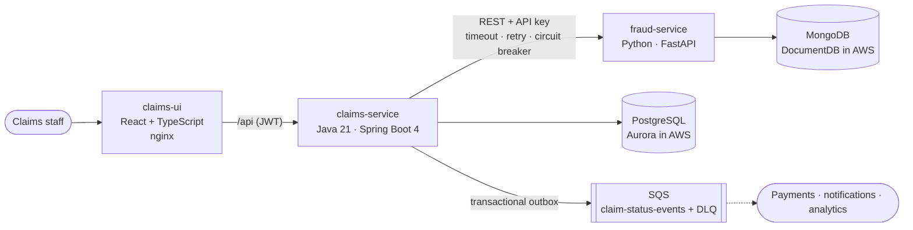

# Claims Platform

A small but production-shaped healthcare claims platform, built to show a modern stack and engineering practices:
Java/Spring Boot microservices,
FastAPI, AWS (Aurora PostgreSQL, SQS, ECS), MongoDB, React, GitHub Actions CI/CD and test automation.

## Quick start

Needs only Docker:

```bash
docker compose up --build -d --wait
```

| What | Where |
|---|---|
| Claims workbench UI | http://localhost:3000 (sign in as `adjudicator` / `adjudicator-pass` or `submitter` / `submitter-pass`) |
| claims-service API docs | http://localhost:8080/swagger-ui.html |
| fraud-service API docs | http://localhost:8000/docs |

Try it: submit a claim (member `AET100000001`, NPI `1234567893`, CPT `99213`, ICD-10 `J45.909`), adjudicate it,
mark it paid. Then submit a suspicious one (CPT `27447`, ICD-10 `J45.909`, 12 units, 4900.00) and watch the fraud
score send it to manual review. Stop everything with `docker compose down`.

## Architecture



- **claims-service** owns claims: intake and validation, a pluggable adjudication rules engine, the status
  state machine, the audit trail, and events published through a transactional outbox.
- **fraud-service** gives each claim an explainable 0-100 risk score and keeps the history in MongoDB.
- **claims-ui** is the adjudicator's workbench.
- Design decisions and trade-offs are in [docs/adr/](docs/adr/). The delivery story is in [docs/backlog.md](docs/backlog.md).

## Stack at a glance

| Capability | Where it's shown |
|---|---|
| Java microservices, Spring Boot, REST | `claims-service`: layered design, RFC 7807 errors, OpenAPI, Flyway, JPA with optimistic locking |
| FastAPI | `fraud-service`: async FastAPI, Pydantic, async PyMongo |
| Full stack | `claims-ui`: React 19, TypeScript strict, TanStack Query, react-hook-form + zod, accessible UI |
| AWS / cloud native | SQS (outbox, DLQ), Aurora Serverless v2, ECS Fargate, ALB, Secrets Manager, CloudWatch in [`infra/terraform`](infra/terraform) |
| RDS/Aurora + NoSQL (MongoDB) | Postgres for claims, MongoDB for scores ([ADR 0002](docs/adr/0002-relational-for-claims-document-store-for-scores.md)) |
| CI/CD in GitHub Actions | [`ci.yml`](.github/workflows/ci.yml), [`cd.yml`](.github/workflows/cd.yml) (OIDC to AWS, gated prod apply), CodeQL, Dependabot |
| Test automation in the SDLC | 226 tests: JUnit/Testcontainers/WireMock, pytest/Testcontainers, Vitest/RTL/MSW, Playwright E2E; coverage gates |
| High-volume enterprise ecosystem | Outbox with `SKIP LOCKED`, circuit breaker, autoscaling, idempotent state transitions, indexes for search |
| Engineering practices | ADRs, CLAUDE.md conventions, linters everywhere, PHI handling ([ADR 0005](docs/adr/0005-security-and-phi-handling.md)) |
| Agile | Sprint-by-sprint backlog with acceptance criteria → tests ([docs/backlog.md](docs/backlog.md)) |
| Adopting AI in delivery | [docs/ai-assisted-development.md](docs/ai-assisted-development.md): workflow, guardrails, and the defects the gates caught |

## Repository layout

| Path | What it is |
|---|---|
| `claims-service/` | Java 21 + Spring Boot 4 claims API (PostgreSQL, Flyway, SQS, Resilience4j, Spring Security) |
| `fraud-service/` | Python 3.13 + FastAPI risk scoring (MongoDB), managed with uv |
| `claims-ui/` | React 19 + TypeScript workbench (Vite), served by nginx in its container |
| `infra/terraform/` | AWS: VPC, ECS Fargate, ALB, Aurora, DocumentDB, SQS, Secrets Manager, alarms, GitHub OIDC |
| `infra/localstack/` | Creates the SQS queue + DLQ in LocalStack |
| `.github/` | CI, CD, CodeQL, Dependabot |
| `docs/` | ADRs, backlog, AI-assisted development notes |

## Developing

Prerequisites: Docker, JDK 21, [uv](https://docs.astral.sh/uv/), Node.js 22+.

```bash
docker compose up -d postgres mongo localstack        # infrastructure only
(cd fraud-service && uv run fraud-service)             # :8000
(cd claims-service && ./mvnw spring-boot:run)          # :8080
(cd claims-ui && npm install && npm run dev)           # :5173, proxies /api to :8080
```

## Testing

| Suite | Command | What it covers |
|---|---|---|
| claims-service | `cd claims-service && ./mvnw verify` | 132 tests: unit, `@WebMvcTest`, Testcontainers (Postgres, LocalStack SQS), WireMock; JaCoCo gate (80% lines, 70% branches; currently ~95%) |
| fraud-service | `cd fraud-service && uv run ruff check . && uv run pytest` | 45 tests incl. Testcontainers MongoDB |
| claims-ui | `cd claims-ui && npm run lint && npm run typecheck && npm run test:coverage` | 44 component tests on the real routes with MSW; 80% gate (currently ~95%) |
| End-to-end | `cd claims-ui && E2E_BASE_URL=http://localhost:3000 npx playwright test` | 5 browser journeys against the full Docker stack |

## Delivery (CI/CD and AWS)

- **CI** ([ci.yml](.github/workflows/ci.yml)), on every PR: only changed services are built. Each gets lint, type
  checks, tests and coverage gates; then the whole stack starts with `docker compose up --wait` and Playwright
  runs against it. CodeQL scans Java, Python, TypeScript and the workflows; Dependabot updates every ecosystem.
- **CD** ([cd.yml](.github/workflows/cd.yml)), after CI passes on `main`: build and push SHA-tagged images (SBOM +
  provenance) to ECR → `terraform plan` → **manual approval** on the `production` environment → apply that exact
  plan → wait for ECS to stabilise → smoke test. GitHub authenticates to AWS with **OIDC**; there are no stored keys.
- **Infrastructure** ([infra/terraform](infra/terraform)): private ECS Fargate services behind an ALB, Service
  Connect between services, Aurora Serverless v2 (writer + reader), DocumentDB, SQS + DLQ, secrets in Secrets
  Manager, deployment circuit breaker with rollback, CPU autoscaling, CloudWatch alarms (DLQ depth, 5xx, unhealthy targets).

To enable CD: run the first `terraform apply` as an administrator (it creates the GitHub deploy role), then set the
repository variables `AWS_DEPLOY_ROLE_ARN` (from the `github_deploy_role_arn` output), `TF_STATE_BUCKET` and
optionally `AWS_REGION`, and add required reviewers to the `production` environment. Until then CD skips itself.

## claims-ui

| Page | What it does |
|---|---|
| `/` | Search claims by member, status and service-date range; filters live in the URL (shareable) |
| `/claims/new` | Multi-line claim form; zod validation mirrors the server rules (incl. NPI Luhn check); server field errors map back onto inputs |
| `/claims/:claimNumber` | Summary, fraud-risk badge, lines, status timeline, and only the actions the current status allows |

TanStack Query owns server state (cache, retries on 5xx only, invalidation after writes). Component tests
run the real routes against an MSW mock API; Playwright runs the full journey against the real services,
including a suspicious claim that the live fraud-service routes to manual review.

## Security

| | |
|---|---|
| **Users** | Demo users `submitter` / `submitter-pass` (role SUBMITTER) and `adjudicator` / `adjudicator-pass` (role ADJUDICATOR) |
| **Login** | `POST /api/v1/auth/token` returns a 1-hour HS256 JWT. In production an identity provider (Cognito/Okta) issues tokens and this endpoint goes away; the resource-server config stays |
| **Authorisation** | SUBMITTER: submit and view. ADJUDICATOR: also adjudicate and change status. Enforced with `@PreAuthorize` next to each endpoint; the UI hides what you can't do, the API refuses it regardless |
| **Errors** | 401/403 are RFC 7807 problem details like every other error |
| **Service-to-service** | claims-service calls fraud-service with an `X-API-Key` (constant-time compared). In AWS: Secrets Manager, or IAM/mTLS |
| **API docs** | Swagger UI at http://localhost:8080/swagger-ui.html (click *Authorize* and paste a token), fraud-service at http://localhost:8000/docs |

```bash
TOKEN=$(curl -s -X POST localhost:8080/api/v1/auth/token -H 'Content-Type: application/json' \
  -d '{"username":"adjudicator","password":"adjudicator-pass"}' | jq -r .accessToken)
curl -H "Authorization: Bearer $TOKEN" localhost:8080/api/v1/claims
```

## Observability

- **Correlation ID**: the UI sends a fresh `X-Correlation-Id` on every call. claims-service accepts it (or makes one),
  puts it in the logging MDC, echoes it, returns it in every error body, and forwards it to fraud-service, which logs it
  too. The UI shows it on errors as a *Reference* for support. One ID finds a request in every service's logs.
- **Logs**: readable text locally; JSON (ECS) in containers (`SPRING_PROFILES_ACTIVE=json-logs`, `FRAUD_LOG_FORMAT=json`).
  Code never logs PHI by design, and a masking layer (member IDs, SSNs, dates of birth) catches anything that slips through.
- **Metrics**: Actuator/Micrometer: adjudication outcomes, outbox publish counts, circuit-breaker state, plus JVM/HTTP.

## claims-service API (v1)

| Method | Path | Notes |
|---|---|---|
| `POST` | `/api/v1/claims` | Submit a claim → `201 Created` + `Location` |
| `GET` | `/api/v1/claims/{claimNumber}` | Claim detail with lines |
| `GET` | `/api/v1/claims?memberId=&status=&from=&to=&page=&size=&sort=` | Paginated search (summary rows, max `size` 100) |
| `POST` | `/api/v1/claims/{claimNumber}/adjudicate` | Run the rules engine → `APPROVED` / `DENIED` / `IN_REVIEW` |
| `PATCH` | `/api/v1/claims/{claimNumber}/status` | Manual transition `{ "status": "PAID", "reason": "..." }` |
| `GET` | `/api/v1/members/{memberId}` | Seeded member |
| `GET` | `/api/v1/providers`, `/api/v1/providers/{npi}` | Seeded providers |

Every error is an RFC 7807 `application/problem+json` body: `400` validation (with a per-field
`errors` list), `404` not found, `409` concurrent modification, `422` business rule (with a stable `code`).

```bash
curl -i -X POST localhost:8080/api/v1/claims -H "Authorization: Bearer $TOKEN" -H 'Content-Type: application/json' -d '{
  "memberId": "AET100000001",
  "providerNpi": "1234567893",
  "serviceDate": "2026-11-01",
  "lines": [{ "procedureCode": "99213", "diagnosisCode": "J45.909", "units": 1, "billedAmount": 125.50 }]
}'

curl -H "Authorization: Bearer $TOKEN" 'localhost:8080/api/v1/claims?memberId=AET100000001&status=SUBMITTED'
```

### Seed data (synthetic, no real PHI)

| Member | Notes | Provider NPI | Notes |
|---|---|---|---|
| `AET100000001` | active, open-ended | `1234567893` | in network |
| `AET100000002` | active until 2026-12-31 | `1987654328` | in network |
| `AET100000003` | active, open-ended | `1456789019` | in network |
| `AET100000004` | **coverage lapsed** 2024-12-31 | `1678901236` | **out of network** |
| `AET100000005` | active from 2026-01-01 | `1321098760` | **out of network** |

## Adjudication

```
SUBMITTED ──► IN_REVIEW ──► APPROVED ──► PAID
    │             │
    ├─────────────┴──► DENIED          (DENIED and PAID are terminal; anything else → 409)
    └──────────────────► APPROVED
```

Rules run in order; the first **deny** wins, otherwise any **review** flag routes to `IN_REVIEW`,
otherwise the claim is **approved** and priced (in-network 80%, out-of-network 50%, `HALF_EVEN`):

| Order | Rule | Outcome |
|---|---|---|
| 10 | `MemberEligibilityRule` | deny `COVERAGE_INACTIVE` if not covered on the service date |
| 20 | `KnownProviderRule` | deny `PROVIDER_UNKNOWN` if the NPI isn't registered |
| 30 | `DuplicateClaimRule` | deny `DUPLICATE_CLAIM` if an earlier claim bills the same member/provider/date/CPT |
| 90 | `FraudRiskRule` | review if fraud-service score ≥ 50, **or if screening is unavailable** |
| 100 | `HighValueReviewRule` | review if billed ≥ `app.adjudication.manual-review-threshold` (5000) |

Add a rule by adding a `@Component` that implements `AdjudicationRule`: nothing else changes.

## Fraud screening (fraud-service)

`POST /v1/score` returns an explainable 0–100 score from rule-based signals (billed amount,
units per line, unit price vs benchmark, procedure/diagnosis mismatch, provider and member velocity),
and stores every assessment in MongoDB (`GET /v1/scores/{claimNumber}` for the history).

- **Pseudonymised storage**: member IDs are HMAC-SHA256 hashed with a secret key before storage;
  velocity checks work on the hash. A TTL index expires documents after `FRAUD_RETENTION_DAYS`.
- **claims-service → fraud-service** uses `RestClient` with connect/read timeouts, a **retry**
  (I/O errors and 5xx only, never 4xx) and a **circuit breaker** (Resilience4j, metrics in Actuator).
- **Fail-safe**: any failure becomes `Unavailable`, which routes the claim to manual review.
  Fraud signals never auto-deny, and an outage never auto-approves.
- The fraud call runs **outside** the DB transaction; the decision is applied afterwards with an
  optimistic version check, so a slow dependency never holds a DB connection.

## Events (transactional outbox → SQS)

Every status change writes a `claim_status_history` row in the **same transaction**. That table is
the audit trail *and* the outbox: `OutboxPublisher` polls unpublished rows
(`FOR UPDATE SKIP LOCKED`, safe with many instances) and sends a `ClaimStatusChanged` event to
the `claim-status-events` SQS queue (with a DLQ). Delivery is at-least-once, so consumers
de-duplicate on `eventId`. Events carry the claim number but no member identifiers.

```bash
docker compose exec localstack awslocal sqs receive-message \
  --queue-url http://localhost:4566/000000000000/claim-status-events --max-number-of-messages 10
```

Local ports: Postgres is on host port **5433** (so it doesn't clash with a locally installed Postgres), Mongo 27017, LocalStack 4566.
